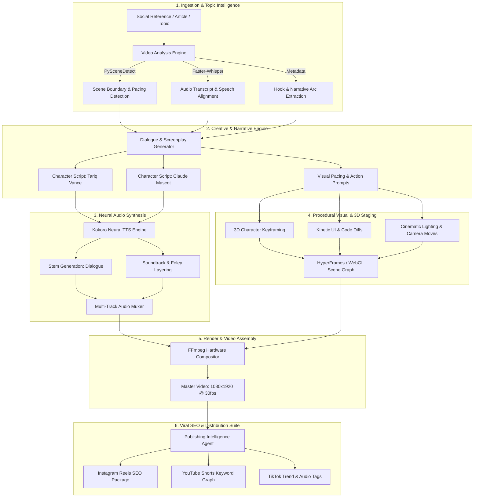

# AI Video Studio: Autonomous Documentary & Short-Form Video Production Engine

[](https://www.python.org/)
[](https://nodejs.org/)
[](https://ffmpeg.org/)
[](https://www.remotion.dev/)
[](https://github.com/SYSTRAN/faster-whisper)
[](#system-architecture)
[](LICENSE)

An enterprise-grade, multi-agent autonomous video studio designed to orchestrate long-form technical documentaries and short-form vertical animations (Instagram Reels, TikTok, YouTube Shorts). The platform automates the complete creative pipeline: from topic research, screenplay writing, and procedural 3D scene synthesis to neural multi-speaker dialogue, cinematic audio mastering, and viral SEO distribution.

---

## Production Demo

<div align="center">
  
  <p><em>Autonomous 3D character dialogue, dynamic UI diffing, and Kokoro neural audio synthesis.</em></p>
  <p>
    <a href="docs/assets/demo.mp4"><strong>[ ▶ Watch Full High-Definition Demo Video (1080 &times; 1920 MP4) ]</strong></a>
  </p>
</div>

The preview above showcases an autonomous render generated by the studio pipeline:
* **Characters:** Procedural 3D low-poly mascot *Claude* and senior developer *Tariq Vance*.
* **Audio Synthesis:** Multi-track neural dialogue voiced via Kokoro TTS with conversational cadence and dynamic sound effects.
* **Rendering Engine:** Real-time WebGL/Canvas kinetic typography and layout orchestration compiled at 1080&times;1920 30 FPS.

---

## System Architecture



---

## Production Tracks & Implementation Status

| Track / Subsystem | Status | Description |
| :--- | :--- | :--- |
| **Short-Form Studio (`Instagram/`)** | **Implemented** | 9:16 vertical pipeline with 3D terracotta mascot Claude & developer Tariq Vance, 4 released episodes, and 23 SEO agent skills. |
| **Modular V2 Engine (`v2_pipeline_orchestrator.py`)** | **Implemented** | 15 specialized director agents (`agents/`) and 5 headless engines (`engines/`) validating across Tasks 01–23. |
| **Documentary Blueprint (`master_pipeline.py`)** | **Implemented** | 19-section production logic benchmark integrating research, 7-layer audio, Remotion, and 7-pillar QA. |
| **Remotion React Suite (`Phase-4_Remotion/`)** | **Implemented** | 16 broadcast React Remotion components (EvidenceCard, DocumentZoom, DataChart, Terminal, Timeline). |
| **YouTube Investigation (`Youtube/youtube_project/`)** | **Implemented** | Investigative forensic documentary pipeline on the $3.5M fake Pokémon box scam. |
| **Automated Direct Uploaders** | *Planned* | Headless API publishing to YouTube Data API v3 and Instagram Graph API. |

---

## Character Bible & Visual Identity

### Claude (Recurring Mascot)
* **Geometry:** Cute low-poly 3D rectangular body with rounded bevels, 2 tilted rectangular black eyes, dual compact arms, and 4 block legs.
* **Emblems:** Central illuminated orange starburst chest insignia and glowing side AI badge.
* **Lighting:** Dark navy/purple moody environments (`#0B0F19`) accented with warm amber/terracotta highlights (`#D97757` / `#FF9F43`).

### Tariq Vance (Developer Protagonist)
* **Role:** Practical, highly experienced software engineer acting as Claude's collaborator and conversational foil.
* **Visual Representation:** Clean stylized developer workspace setup with multi-monitor terminal feeds, ambient code editor themes, and keyboard Foley.

---

## Clean Directory Layout

```text
AI_Video_studio/
├── docs/
│   └── assets/                     # Demo video (demo.mp4) & preview animation (demo_preview.gif)
├── Instagram/                      # Autonomous short-form (9:16) production track
│   ├── agent-talk-content-system/  # 23 Social media growth skills & brand guidelines
│   ├── projects/                   # Short-form video projects (01 to 04)
│   ├── scripts/                    # Video analysis (analyze_video.py) & ingestion scripts
│   └── exports/                    # Master rendered releases
├── Youtube/                        # Long-form video essay track
│   └── youtube_project/            # Full-length forensic documentary pipelines & assets
├── agents/                         # 15 Discrete director agents (V2 architecture)
├── engines/                        # Headless execution engines (Blender, Gemini, Remotion, FFmpeg, Evidence)
├── brand/                          # Brand style bibles, typography, and color systems
├── schemas/                        # 14 Formal JSON schemas validating every production step
├── production/                     # Production assets, scripts, graphics, narration, and QA outputs
├── projects/                       # Documentary projects repository (video-001, video-002, video-003)
├── qa/                             # Quality assurance report data
├── research/                       # Canonical factual claim and source grounding repositories
├── scripts/                        # Utility scripts (build_full_video_003_data.py)
├── tests/                          # Automated verification test suites
│   ├── fixtures/                   # Canonical reference fixtures (master_documentary contracts)
│   ├── test_production_logic_spec.py
│   ├── test_v2_documentary_architecture.py
│   ├── test_video_003_astra.py
│   └── test_gemini.py
├── Phase-0_Research/ ... Phase-7_QA/ # Specification prototype modules & Remotion React app
├── .env.example                    # Template environment configuration
├── .gitignore                      # Strict privacy & large binary exclusion rules
├── CONTRIBUTING.md                 # Developer contribution guidelines
├── LICENSE                         # MIT License
├── REPOSITORY_AUDIT.md             # Complete file-by-file audit & architectural report
└── README.md                       # Master repository documentation
```

---

## Testing & Verification

All test suites validate cleanly without regression:

```bash
# 1. Test Modular V2 Multi-Agent Architecture (Tasks 01 to 23)
python tests/test_v2_documentary_architecture.py

# 2. Test 19-Section Production Logic Specification
python tests/test_production_logic_spec.py

# 3. Test Video-003 Data Contracts & Integrity
python tests/test_video_003_astra.py
```

---

## Engineering Standards & Privacy

* **Zero Hardcoded Machine Paths:** All local paths, credentials, and API keys are strictly dynamically discovered (`Path(__file__).resolve()` in Python, `import.meta.url` in Node.js).
* **Enterprise Git Hygiene:** Intermediate raw frames, temporary download caches (`downloads/`), and uncompressed binary beds are explicitly omitted via `.gitignore`.
* **Deterministic Builds:** Pinned package lockfiles and isolated virtual environments ensure repeatable render pipelines across Linux and Windows developer machines.

---

## License

This project is licensed under the MIT License — see the [LICENSE](LICENSE) file for details.
