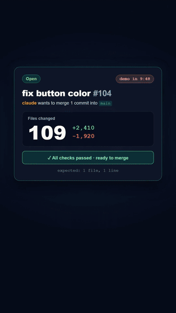
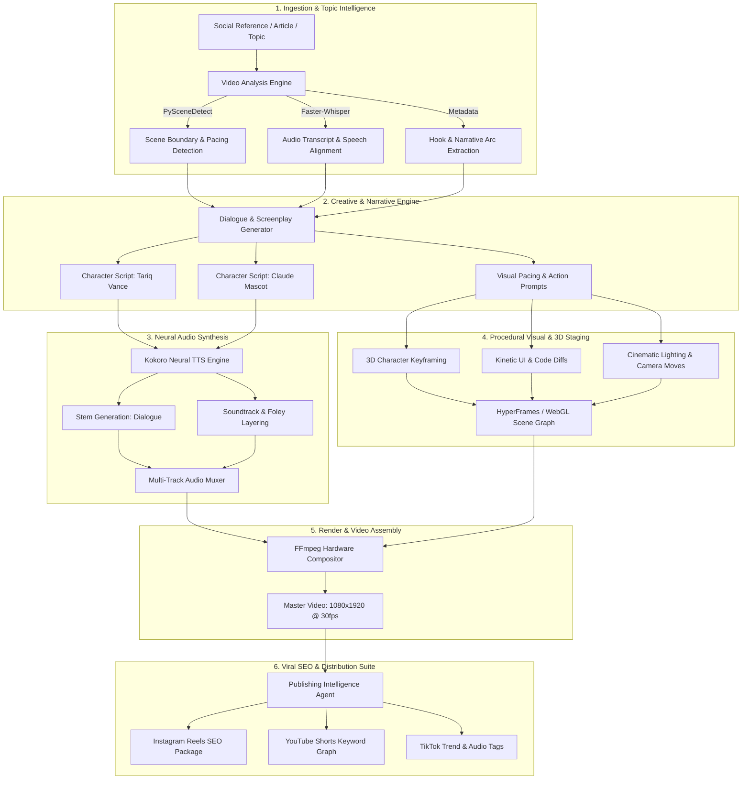

# AI Video Studio: Autonomous Documentary & Short-Form Video Production Engine

[](https://www.python.org/)
[](https://nodejs.org/)
[](https://ffmpeg.org/)
[](https://www.remotion.dev/)
[](https://github.com/SYSTRAN/faster-whisper)
[](#system-architecture)
[](LICENSE)

An enterprise-grade, multi-agent autonomous video studio designed to orchestrate long-form technical documentaries and short-form vertical animations (Instagram Reels, TikTok, YouTube Shorts). The platform automates the complete creative pipeline: from topic research, screenplay writing, and procedural 3D scene synthesis to neural multi-speaker dialogue, cinematic audio mastering, and viral SEO distribution.

---

## Production Demo

<div align="center">
  
  <p><em>Autonomous 3D character dialogue, dynamic UI diffing, and Kokoro neural audio synthesis.</em></p>
  <p>
    <a href="docs/assets/demo.mp4"><strong>[ ▶ Watch Full High-Definition Demo Video (1080 &times; 1920 MP4) ]</strong></a>
  </p>
</div>

The preview above showcases an autonomous render generated by the studio pipeline:
* **Characters:** Procedural 3D low-poly mascot *Claude* and senior developer *Tariq Vance*.
* **Audio Synthesis:** Multi-track neural dialogue voiced via Kokoro TTS with conversational cadence and dynamic sound effects.
* **Rendering Engine:** Real-time WebGL/Canvas kinetic typography and layout orchestration compiled at 1080&times;1920 30 FPS.

---

## System Architecture



---

## Core Subsystems

### 1. Instagram Reels & Short-Form Studio (`Instagram/`)
Autonomous vertical video generator engineered for high-retention technical and developer storytelling under the **Agent Talk** (`@agent.talk`) brand identity:
* **Episodic Productions:**
  * `01-one-small-fix/`: Indie developer vs rogue coding agent refactoring 200 files.
  * `02-four-hundred-messages/`: Mascot relationship dynamics and coding assistant confessions.
  * `03-claude-on-phone/`: Mobile agent deployment and remote developer debugging.
  * `04-openshorts-gta6/`: AI stream-clipping and automated short generation analysis.
* **Social SEO & Growth Automation:** 23 integrated agent skills covering hook generation, semantic keyword dictionaries, competitor analysis, and multi-platform publishing packages.
* **Computer Vision & Audio Profiling:** `scripts/analyze_video.py` utilizes `faster-whisper` and `PySceneDetect` to evaluate pacing, cut frequency, and speech clarity.

### 2. Long-Form Documentary Studio (`Youtube/`)
Multi-phase documentary architecture built for deep-dive technical explorations:
* Automated narration planning (`narration.json`) and continuity bible generation.
* Blender 3D scene direction and ShotDirector camera automation.
* Remotion composition trees for chapter markers and data visualizations.

---

## Character Bible & Visual Identity

### Claude (Recurring Mascot)
* **Geometry:** Cute low-poly 3D rectangular body with rounded bevels, 2 tilted rectangular black eyes, dual compact arms, and 4 block legs.
* **Emblems:** Central illuminated orange starburst chest insignia and glowing side AI badge.
* **Lighting:** Dark navy/purple moody environments (#0B0F19) accented with warm amber/terracotta highlights (#D97757 / #FF9F43).

### Tariq Vance (Developer Protagonist)
* **Role:** Practical, highly experienced software engineer acting as Claude's collaborator and conversational foil.
* **Visual Representation:** Clean stylized developer workspace setup with multi-monitor terminal feeds, ambient code editor themes, and keyboard Foley.

---

## Directory Layout

```text
AI_Video_studio/
├── docs/
│   └── assets/                     # Demo video (demo.mp4) & preview animation (demo_preview.gif)
├── Instagram/
│   ├── agent-talk-content-system/  # 23 Social media skills & brand guidelines
│   │   ├── .agents/brand/          # Voice guides, audience profiles, keyword dictionaries
│   │   └── .agents/skills/         # Foundation, writing, SEO, video, and analytics skills
│   ├── projects/                   # Short-form video project directories
│   │   ├── 01-one-small-fix/
│   │   ├── 02-four-hundred-messages/
│   │   ├── 03-claude-on-phone/
│   │   └── 04-openshorts-gta6/
│   ├── scripts/
│   │   ├── analyze_video.py        # Video analysis via PySceneDetect & faster-whisper
│   │   └── download-video.ps1      # High-performance reference ingestion script
│   └── exports/                    # Master rendered releases
├── Youtube/
│   └── youtube_project/            # Full-length documentary pipelines & assets
├── Phase-0_Research/               # Research ingestion modules
├── Phase-1_MuMuAINovel/            # Narrative ideation & plot orchestration
├── Phase-2_ShotDirector/           # Camera direction & storyboard planning
├── Phase-3_Blender/                # 3D assets & environmental setup
├── Phase-4_Remotion/               # React-based programmatic video rendering
├── Phase-5_Footage/                # B-roll & historical visual libraries
├── Phase-6_Assembly/               # Final timeline conformance
├── Phase-7_QA/                     # Automated QA & continuity auditing
├── .gitignore                      # Strict privacy & large binary exclusion rules
└── README.md                       # Repository master documentation
```

---

## Getting Started

### Prerequisites
* **Python 3.10+** (with virtual environment support)
* **Node.js 20+** & **npm**
* **FFmpeg 7.0+** (must be available on system `$PATH`)

### 1. Installation

Clone the repository and install dependencies:

```bash
git clone https://github.com/SaiSankeerth-dev/AI_Video_studio.git
cd AI_Video_studio

# Install Python analysis dependencies
python -m venv .venv
source .venv/bin/activate  # Or on Windows: .venv\Scripts\Activate.ps1
pip install faster-whisper scenedetect[opencv] click tabulate
```

### 2. Video Analysis CLI

Analyze any reference video for pacing, cuts, speech, and viral hook efficiency:

```bash
python Instagram/scripts/analyze_video.py path/to/reference_video.mp4 --out-dir reports/
```

### 3. Generate Speech & Dialogue Stems

Synthesize multi-character dialogue using the neural speech toolchain:

```bash
cd Instagram/projects/04-openshorts-gta6
node scripts/generate_dialogue.mjs
```

### 4. Render Master Composition

Trigger hardware-accelerated video rendering:

```bash
ffmpeg -y -i assets/audio/master_audio.wav -i project/video_stream.mp4 \
  -c:v libx264 -crf 22 -preset medium \
  -c:a aac -b:a 192k -movflags +faststart \
  exports/final_render.mp4
```

---

## Engineering Standards & Privacy

* **Zero Hardcoded Environment Secrets:** All local machine paths, credentials, and API keys are strictly loaded via `.env` or dynamic runtime discovery (`process.env.APPDATA`, `import.meta.url`).
* **Clean Git Hygiene:** Intermediate raw frames, temporary download caches (`downloads/`), and uncompressed binary beds are explicitly omitted via `.gitignore`.
* **Deterministic Builds:** Pinned package lockfiles and isolated virtual environments ensure repeatable render pipelines across Linux and Windows developer machines.

---

## License

This project is licensed under the MIT License — see the [LICENSE](LICENSE) file for details.
